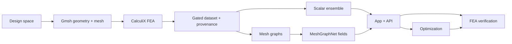

# SurroSim

[](https://github.com/EdwardNguyen2854/dev-surrosim/actions/workflows/ci.yml)
[](LICENSE)
[](pyproject.toml)
[](CHANGELOG.md)

**SurroSim** is a reproducible engineering-AI platform that learns fast,
trustworthy surrogates for six parametric cantilever families — plate with
hole, two-hole plate, tapered plate, stepped plate, I-beam, and L-bracket — and
keeps every prediction traceable to validated CalculiX finite-element (FEA)
data.

The point is not just speed. A surrogate that is fast and wrong is worse than
no surrogate, so SurroSim records where each label came from, refuses to train
on failed simulations, measures model error on splits the model never saw, and
tells the user when a design has left the region the model can be trusted in.

> **Status.** v0.1.0 is the first public release. It ships the whole pipeline:
> six shape families, a 2,809-case gated dataset, shape-conditioned scalar
> surrogates, a MeshGraphNet field model, the API, the web app, the desktop
> shell, and one-command reproduction.
>
> The two model registries that serve all six shapes are reviewed
> **candidates**, not validated production models: their accuracy is measured
> and published, but per-shape review is still open. Candidate metrics are
> labelled as such throughout.
>
> Documents written before publication refer to internal development
> milestones by number (v0.6, v1.0, v2.0). Those were private milestones, not
> public releases; the public history starts at v0.1.0.



## Results at a glance

Single-shape evidence (644 solved cases, from the private v1.0/v1.1
development milestone):

| Stage | Evidence |
| --- | --- |
| FEA engine | C3D10 mid-span stress within **0.7%** of beam theory; mesh convergence documented; C3D4 shown unusable for bending |
| Dataset | 644/644 cases passed all six label gates; 0 failures; challenge split held out |
| Scalar surrogates | GP+MLP ensemble: **1.74–2.30% test MAPE** (1.9–6.7% on held-out design-space corners); ~10 µs inference vs ~10 s solve |
| Field prediction | MeshGraphNet: **2.63%** test global peak-stress error, 0.80% median nodal field error; ~4× better than a coordinate-MLP baseline |
| Optimization | 3,660 surrogate evaluations in 17 s; **5/5** finalists FEA-feasible with 0.4–2.3% stress error |

Six-shape candidates shipped in this release (2,809 gated cases; reviewed but
not yet validated for production):

| Stage | Candidate evidence |
| --- | --- |
| Dataset | 2,809/2,809 cases passed the label gates; 0 failures; 349 challenge cases held out |
| Scalar surrogates | Test MAPE 1.27% (displacement), 2.29% (global peak stress), 2.01% (stress-riser region) |
| Field prediction | Test global peak-stress MAPE 3.24%, challenge 5.04%, median nodal error 0.79% |
| Honest selection | Model choice uses validation data only; test and challenge numbers are reported afterwards, never used to pick a model |

Reports: [validation](docs/validation_report.md) ·
[scalar comparison](reports/v0.4_scalar_comparison.md) ·
[field prediction](reports/v0.6_gnn_field_prediction.md) ·
[optimization](reports/v1.0_optimization.md) ·
[v2 scalar candidate](reports/v2.0_scalar_reviewed_candidate.md) ·
[v2 GNN candidate](reports/v2.0_gnn_normalized_holdout.md).

## Quick start

Python 3.11 or newer. The core library needs only NumPy and SciPy; the solver
stages also need [Gmsh](https://gmsh.info/) and
[CalculiX](https://www.calculix.de/).

```bash
python -m venv .venv

# Windows
.venv\Scripts\python.exe -m pip install -e ".[dev,mesh,ml,app,gnn]"
.venv\Scripts\python.exe -m pytest -q -m "not solver"

# macOS / Linux
.venv/bin/python -m pip install -e ".[dev,mesh,ml,app,gnn]"
.venv/bin/python -m pytest -q -m "not solver"
```

That is the CI fast lane: 84 unit, fixture, and contract tests that need no
solver binary. The `solver`-marked tests skip themselves when Gmsh or CalculiX
is missing.

### Run the real solver end to end

```bash
# ~4 minutes on 4 jobs; writes runs and a small dataset under outputs/
python -m surrosim reproduce --profile quick --jobs 4 --ccx ccx

# or the simulator test alone
python -m pytest -q -m "solver"
```

Windows bundles nothing you cannot see: `tools/calculix/ccx.exe`, when present,
is picked up automatically. On Linux install `calculix-ccx` from your package
manager. Point at a specific binary with `--ccx /path/to/ccx` or the
`SURROSIM_CCX` environment variable.

### Engineering application

The app is a React + TypeScript single-page application served by a FastAPI
service. Background jobs (FEA verification, field prediction, optimization)
stream progress and logs through the API, so the interface never blocks.

```bash
# API + built app on http://localhost:8003
# The defaults (models/scalar/v2, models/gnn/v2) are the future release paths,
# so point at the registries that exist in this checkout:
python -m surrosim serve \
  --registry models/scalar/v2_reviewed_candidate \
  --field-model models/gnn/v2_normalized_candidate
```

For v1 registries use `--registry models/scalar/v1 --field-model models/gnn/v1`.
Without `--field-model`, the field pages fall back to the scalar registry where
they can.

```bash
# Development: Vite dev server on http://localhost:5173 (proxies the API)
cd apps/web
npm ci
npm run dev

# Production build check (type-check, then Vite build)
npm run build
```

Pages: **Design Explorer** (live parametric schematic, confidence and
out-of-distribution panel, analytical reference), **Field Prediction**
(MeshGraphNet nodal fields in 3D), **FEA Verify** (real CalculiX round trip
with a streamed job log), **Optimization** (constrained mass minimisation with
candidate verification), **Model** (plain-language evidence, accuracy tables,
training detail), **Dataset** (the solved-example answer key), **Solver** (how
the finite-element engine works, step by step, with validation evidence),
**Documentation** (a multi-page manual in plain language), and **Settings**
(theme and sidebar preferences saved on the device).

Docker: `docker compose -f docker/docker-compose.yml up --build` serves app and
API on port 8000. The image builds the frontend and installs CPU-only PyTorch.
CalculiX is not bundled, so the FEA verification page is disabled there.

### Desktop app (Windows)

A native window around the same app for machines with this repository checked
out. One click builds what is missing, starts the local service, and opens the
window; everything stays offline, including real CalculiX verification.

```bat
start-desktop.bat
```

Optional Start Menu shortcut:
`powershell -ExecutionPolicy Bypass -File tools\create-shortcut.ps1`
(add `-StartMenu`). Details and environment variables:
[apps/desktop/README.md](apps/desktop/README.md).

## Full pipeline

```bash
# 1. Designs: v1 plate table plus ~380 sampled cases per new shape
#    (Sobol plus challenge corners and edge cases, deterministic splits)
surrosim dataset sample --out data/designs_v2.csv

# 2. Production FEA dataset (parallel, resumable, gated).
#    Reuse the committed v1 plate labels as a base; only new shapes are solved.
surrosim dataset run --designs data/designs_v2.csv --out data/runs_v2 --jobs 4 --ccx ccx
surrosim dataset build --designs data/designs_v2.csv --runs data/runs_v2 \
    --base data/dataset_v1/dataset.csv --out data/dataset_v2

# 3. Shape-conditioned scalar surrogates
surrosim train scalar --dataset data/dataset_v2/dataset.csv --out models/scalar/v2

# 4. Field model (coarse graph profile, all shapes)
surrosim dataset run --designs data/designs_v2.csv --out data/runs_v2_graph \
    --jobs 4 --mesh-profile graph --ccx ccx
surrosim graph export --designs data/designs_v2.csv --runs data/runs_v2_graph --out data/graphs_v2
surrosim train gnn --graphs data/graphs_v2 --runs data/runs_v2_graph --out models/gnn/v2

# 5. Optimization with FEA verification
surrosim optimize --shape plate --ccx ccx

# Or everything at once (hours)
surrosim reproduce --profile full --jobs 4 --ccx ccx
```

`dataset run` is resumable and writes `data/runs_*`. Never point two writers at
the same output directory. See
[multi-shape pipeline operations](docs/v2_pipeline_operations.md).

## Repository layout

```
src/surrosim/       shapes registry, plate, mesh policy, sampling, geometry,
                    simulation, validation, dataset, ml, gnn, serving,
                    optimize, reproduce
apps/web/           React + TypeScript engineering app (Vite, Tailwind)
apps/desktop/       Electron desktop shell for the local app (Windows)
tests/              unit, fixture, and solver-integration tests
data/designs_v2.csv multi-shape design table (inputs only)
data/dataset_v1/    committed v1 plate labels, manifest, and dataset card
data/dataset_v2/    multi-shape dataset (reuses the v1 plate labels)
models/             trained registries (scalar v1/v2, GNN v1/v2)
reports/            validation, comparison, field, and optimization reports
docs/               architecture, validation, reproducibility, limitations, cards
docker/             app and API packaging
```

`docs/README.md` is the documentation index. `blog/` holds the long-form
write-up and its generated figures.

## Provenance and trust

Every label records solver status, exact force balance, mesh policy, quality,
and runtime. Every model records its dataset SHA-256, configuration, and git
commit. The app reports domain bounds, an out-of-distribution score, ensemble
disagreement, and recommends running the solver when support is weak. Failed
simulations never enter a dataset. Details:
[architecture](docs/architecture.md).

## Limitations

Linear elasticity only; closed design space; no experimental correlation;
heuristic confidence signals. Read
[limitations and out of scope](docs/limitations_and_out_of_scope.md) before
drawing engineering conclusions. **Predictions require independent engineering
verification before any safety-relevant use.**

## License and attribution

SurroSim is released under the [Apache License 2.0](LICENSE). You may use it,
modify it, embed it, and ship it commercially, including in closed-source
products.

In return the license requires that you keep the credit:

- Keep the [LICENSE](LICENSE) and [NOTICE](NOTICE) files with any copy,
  fork, or packaged build. The NOTICE file names the author and must stay
  readable in the source form or documentation you distribute.
- Keep the copyright line intact, and mark the files you changed.
- If you publish a fork or a derived product, say that it is based on SurroSim
  and link back to this repository.

Third-party components keep their own licenses. CalculiX and Gmsh are GPL
software called as external binaries and are not redistributed here; the three
bundled typefaces are under the SIL Open Font License. See the
[NOTICE](NOTICE) file for the full list.

If you would rather have a different arrangement — for example a commercial
license without the notice obligations, or a copyleft variant — open an issue
to discuss it.

## Citation

If you use SurroSim in research or teaching, cite it using
[CITATION.cff](CITATION.cff). GitHub's "Cite this repository" button reads that
file directly.

## Contributing

Contributions are welcome. Start with [CONTRIBUTING.md](CONTRIBUTING.md) for
the setup, the evidence rules, and the sign-off requirement. Participation is
covered by the [Code of Conduct](CODE_OF_CONDUCT.md). Report security issues
privately as described in [SECURITY.md](SECURITY.md).

Good first contributions: reproduce a published number and report whether you
matched it, improve a confusing page of the manual, or add a test for an edge
case you hit.

## Where to read more

[Architecture](docs/architecture.md) ·
[Vision](VISION.md) ·
[Validation report](docs/validation_report.md) ·
[Reproducibility](docs/reproducibility.md) ·
[Multi-shape operations](docs/v2_pipeline_operations.md) ·
[Limitations](docs/limitations_and_out_of_scope.md) ·
[Model cards](docs/README.md#models) ·
[Changelog](CHANGELOG.md) ·
[Working notes for AI agents](AGENTS.md)
