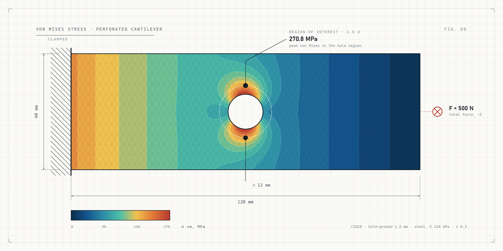

# Blog artwork

Hand-built vector figures for a SurroSim blog post, rendered to high-resolution
PNG, plus one animated clip. Nothing here uses an image generator: every line,
label and colour is authored geometry, so the numbers and annotations are exact
and the type stays crisp at any size.

## What is in `assets/`

| file | size | where it goes |
| --- | --- | --- |
| `hero.png` | 2560 × 1280 | Top-of-post banner (2:1) |
| `social-card.png` | 2400 × 1260 | Open Graph / X / LinkedIn preview (1.91:1) |
| `fig-01-pipeline.png` | 2400 × 1280 | Section: how the pipeline is built |
| `fig-02-shape-families.png` | 2400 × 940 | Section: engineering scope |
| `fig-03-speed.png` | 2000 × 880 | Section: why speed matters |
| `fig-04-scalar-accuracy.png` | 2000 × 1080 | Section: scalar accuracy |
| `fig-05-field-accuracy.png` | 2000 × 940 | Section: field (GNN) accuracy |
| `fig-06-mesh-convergence.png` | 2000 × 980 | Section: why quadratic tetrahedra |
| `fig-07-provenance.png` | 1440 × 1120 | Section: traceability |
| `fig-08-solver-vs-surrogate.mp4` | 1280 × 720, 10 s | Inline clip or social video |
| `fig-08-solver-vs-surrogate.webm` | 1280 × 720, 10 s | Smaller fallback for the same clip |
| `fig-09-app-explorer.png` | 2880 × 2536 | Product shot: design explorer |
| `fig-10-app-field.png` | 2880 × 2832 | Product shot: 3D field viewer |
| `fig-11-app-optimization.png` | 2880 × 3976 | Product shot: optimization run |
| `fig-12-app-fea-verify.png` | ~1770 × 740 | Detail crop: surrogate versus CalculiX |

The `fig-09`–`fig-12` shots are captured from the running app rather than drawn;
`capture_app.py` reproduces them (see below). `fig-12` is a crop of the
comparison panel, taken with the page scrolled to the verification result.

All PNGs are rendered at 2× so they stay sharp on high-density screens and in
print. The MP4 is H.264 with `faststart`, so it streams in an ``-like way
without a poster frame.

## Suggested alt text

Alt text is what a screen reader announces; it should describe the figure, not
repeat the caption.

- **hero** — "Plane view of a 120 by 40 millimetre perforated cantilever plate
  under a 500 newton tip load, coloured by von Mises stress. The stress peaks at
  the hole, inside a dashed region of interest drawn at one and a half hole
  diameters."
- **social-card** — "Card reading: the solver, in microseconds. Surrogate models
  for structural FEA."
- **fig-01** — "Six-stage pipeline from design sampling through meshing,
  solving, label gating, training and serving, with the artifact each stage
  produces."
- **fig-02** — "Line drawings of the six parametric cantilever families: plate,
  multi-hole plate, taper, stepped, I-beam and L-bracket, each marked with its
  clamp, tip load and stress-riser region."
- **fig-03** — "A logarithmic timeline comparing a 10.05 second finite element
  solve with a 10 microsecond surrogate evaluation, about one million times
  faster."
- **fig-04** — "Bar chart of mean absolute percentage error for the three
  scalar targets on the test and challenge splits, against the Euler–Bernoulli
  baseline of 3.56 percent."
- **fig-05** — "Bar chart showing the mesh graph network reaching 2.63 percent
  error on test and 9.14 percent on challenge, against 10.47 and 28.24 percent
  for a per-node multilayer perceptron."
- **fig-06** — "Dot plot of tip displacement error: linear tetrahedra at minus
  19.3 percent and quadratic tetrahedra converging to minus 2.35 percent."
- **fig-07** — "Nested chain from a prediction down through model metadata,
  dataset and design hashes, a per-case run record and geometry metadata."
- **fig-08** — "Animation: both lanes start together; the surrogate finishes
  immediately while the finite element solve keeps counting to 10.05 seconds."
- **fig-09** — "The SurroSim design explorer: shape family and sliders on the
  left, a dimensioned schematic in the middle, predicted values and a confidence
  panel on the right."
- **fig-10** — "A 3D view of the plate coloured by predicted von Mises stress,
  with the concentration around the hole and a legend from 1.9 to 268.5 MPa."
- **fig-11** — "The optimization page: a scatter of 3,660 evaluations plotting
  mass against predicted peak stress, a convergence chart and a ranked table of
  five finalists."
- **fig-12** — "A comparison table of surrogate versus CalculiX on three
  quantities, with errors of plus 0.14, plus 3.33 and minus 0.05 percent, and a
  solver runtime of 3.8 seconds on a 19,344-node mesh."

## Embedding

```html
<figure>
  
</figure>

<figure>
  <video src="/blog/assets/fig-08-solver-vs-surrogate.mp4"
         autoplay muted loop playsinline width="1280" height="720"></video>
  <figcaption>Same part, same question: 10.05 s against 10 µs.</figcaption>
</figure>
```

Keep `width`/`height` on every image and video so the browser reserves space
and the text does not jump while the page loads.

## The post

`introducing-surrosim.md` is the article these assets were made for. It is plain
Markdown with relative image paths (`assets/...`) and one raw `<video>` tag, so
it drops into most static-site generators unchanged.

To read it with the figures in place:

```powershell
.venv\Scripts\python.exe blog\preview.py   # renders .preview/post.html + screenshots
```

**Sizing.** Figures are designed at 1000–1200 px and read best at 700 px or
wider. If your column is narrower, give the images a full-bleed or
click-to-enlarge treatment rather than shrinking them — the annotation type is
around 10 px at design size.

## Regenerating

Everything is source-controlled and deterministic:

```powershell
.venv\Scripts\python.exe blog\render.py            # all artboards
.venv\Scripts\python.exe blog\render.py hero fig-03  # just two
.venv\Scripts\python.exe blog\record_video.py      # re-record the clip
```

Product screenshots need the app running first:

```powershell
.venv\Scripts\python.exe -m surrosim serve --port 8013 `
    --registry models/scalar/v2_reviewed_candidate `
    --field-model models/gnn/v2_normalized_candidate
.venv\Scripts\python.exe blog\capture_app.py
```

`capture_app.py` assumes the field model and CalculiX are available; the
screenshots include the result of a background job, so each page is driven
(click, wait, capture) rather than snapshotted empty.

- `src/artboards.html` — every still, as inline SVG inside one page. Board sizes
  and the type system live in the `<style>` block; the data for each chart is a
  plain array just above the drawing code.
- `src/race.html` — the animation. The timeline is a single `frame(t)` function,
  so retiming is a matter of changing the constants at the bottom.
- `render.py` / `record_video.py` — headless Chromium; no fonts or packages to
  install beyond Playwright.

To change a number, edit the array in `src/artboards.html` and re-run
`render.py`. To retitle the social card, edit the HTML string in the `social()`
block.

## Where the numbers come from

Every figure cites the same sources as the docs, so the post can be fact-checked:

| number | source |
| --- | --- |
| 1.85% / 2.30% / 1.74% test MAPE | `docs/validation_report.md` §3 |
| 5.39% / 6.73% / 6.14% challenge MAPE | same table |
| 3.56% Euler–Bernoulli baseline | same section |
| 10.05 s median solve, ~10 µs evaluation | same section |
| 644 gated cases, zero failures | §2 |
| 2.63% / 9.14% MeshGraphNet error | §4 |
| 10.47% / 28.24% per-node MLP error | §4 |
| −19.3% and −2.35% mesh error | §1 |
| 270.8 MPa peak ROI stress | §1, hole-graded 1.2 mm row |

The colour field in the hero and the thumbnails is an analytic illustration of a
cantilever with a hole, not solver output; the annotation it carries (270.8 MPa
at the hole) is the value from the validation table for that geometry.
