# Introducing SurroSim

**A ten-second finite-element solve, replaced by a ten-microsecond prediction —
with the paperwork to prove the substitution holds.**

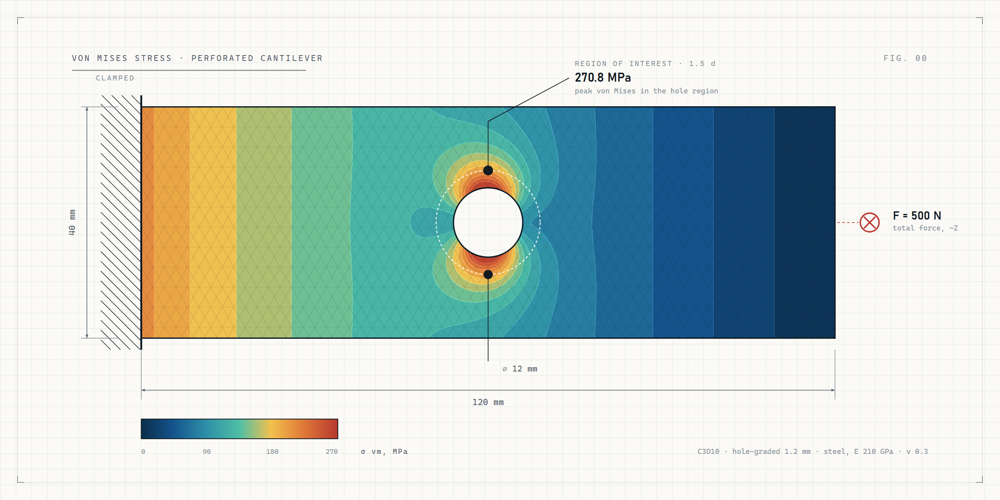

Every structural design question collapses into the same shape sooner or later:
*what happens if I change this dimension?* Answering it properly means meshing
the part and running a finite-element analysis — FEA, the numerical method that
solves the underlying equations of elasticity on a mesh of small elements.

For the cantilever plate above — 120 mm long, 40 mm wide, 6 mm thick, a 12 mm
hole through the middle, 500 N pulling down on the free end — that analysis
takes about ten seconds on a normal machine. Ten seconds is nothing. It stops
being nothing when you need it ten thousand times, which is roughly what a
design search requires.

SurroSim is an answer to that arithmetic. It learns the input-to-output map of a
narrow, well-defined family of parts from thousands of solver runs, then answers
in microseconds — and, just as importantly, tells you when its answer should not
be trusted.

<video src="assets/fig-08-solver-vs-surrogate.mp4" autoplay muted loop playsinline width="1280" height="720"></video>

*Same part, same question. The surrogate lane finishes almost immediately; the
solver lane is still counting when it does. ([WebM version](assets/fig-08-solver-vs-surrogate.webm))*

## Ten seconds, or ten microseconds

The headline is a ratio, and it is worth looking at properly, because ratios on
a log axis hide a lot of detail.

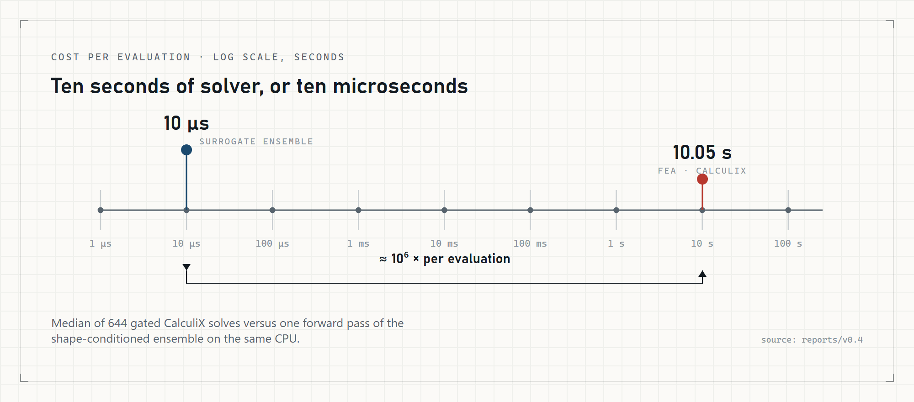

A finite element solve scales with the mesh. The surrogate does not scale with
anything: it is a fixed number of floating-point operations, whatever the design.
That is why the gap is not "a bit faster" but six orders of magnitude, and why
the interesting question stops being *how fast* and becomes *how often can I be
wrong*.

One honest footnote on that number. Inside the application, the panel labelled
"surrogate latency" reports the whole round trip — HTTP request, feature
construction, JSON response — which lands in the low milliseconds. The model
evaluation itself is the ten microseconds. Both numbers are true; they measure
different things.

## What a surrogate model actually is

A surrogate is not a smaller solver. It contains no equations of elasticity and
no notion of stiffness. It is a statistical approximation of the function

> (geometry, load) → (displacement, stress)

fitted to a set of examples produced by the real solver. Where the solver
integrates, the surrogate interpolates.

That distinction sets the ground rules:

- **It is only valid where it has seen data.** Outside the sampled parameter
  ranges it may produce a plausible number that means nothing. SurroSim treats
  this as a first-class failure mode rather than an edge case.
- **Its accuracy is statistical, not guaranteed.** A median error of 1.8% says
  nothing about any single prediction. The distribution matters more than the
  mean.
- **Someone still has to run the solver.** Not to check every answer — that
  would defeat the purpose — but to check the answers you are about to act on.

Everything else in this post is machinery built around those three sentences.

## Six shapes, one load case

The scope is deliberately narrow. SurroSim covers six parametric cantilever
families, all in linear elastic steel, all under one load case: a single total
force applied at the free end, with the other end fully clamped.

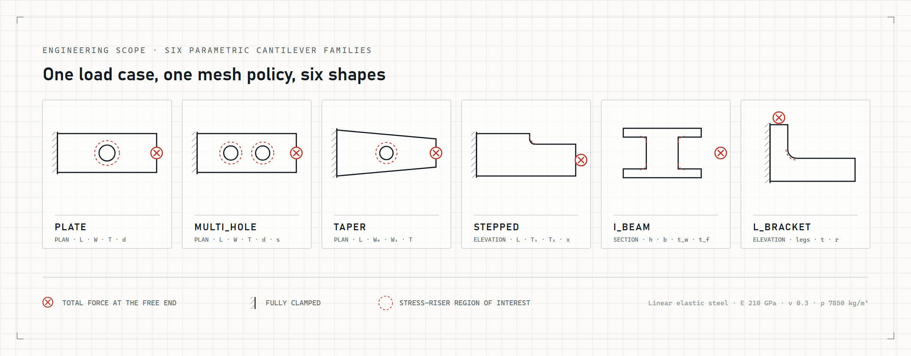

Narrow scope is the point. A model that works across the whole of mechanical
engineering does not exist; a model that works across six families with
documented parameter ranges can be validated honestly, and its failure modes can
be enumerated rather than discovered.

Each family declares the parameters it varies, the faces that are clamped and
loaded, the direction of the load, the region where stress is expected to
concentrate, and its analytic mass. That registry is the single source of truth
for the shape's engineering definition — adding a family still touches sampling,
geometry, mesh policy, serving and the UI, but every one of those reads the same
declaration rather than re-deriving it.

## How the model is built

The pipeline is the interesting part, because it is where trust is either
created or lost.

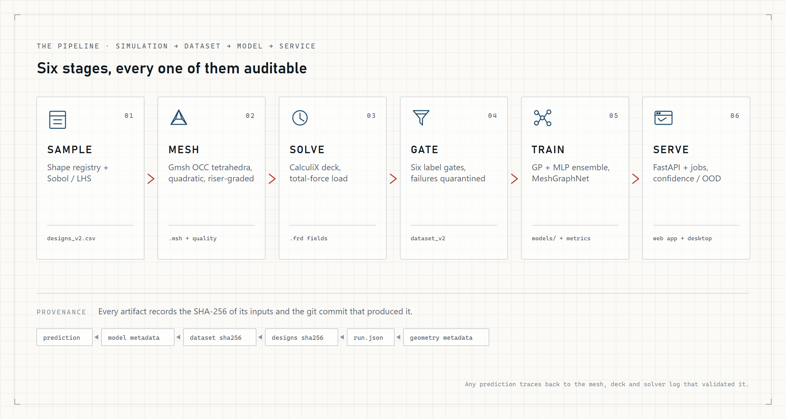

1. **Sample.** A space-filling design (Sobol sequences, plus deliberately
   awkward corner cases) proposes candidate designs.
2. **Mesh.** Gmsh builds the geometry and a quadratic tetrahedral mesh — the
   C3D10 element, which matters more than it sounds, and gets its own section
   below.
3. **Solve.** CalculiX runs the case. The requested force is distributed as
   consistent nodal loads that sum to exactly the requested total, so refining
   the mesh never changes the applied load.
4. **Gate.** Every result must pass a set of checks — solver status, exact force
   balance, mesh size, field presence, finite and positive outputs — before it
   becomes a label. A failed simulation is quarantined, never quietly absorbed.
5. **Train.** A shape-conditioned ensemble of Gaussian processes and neural
   networks learns the three scalar targets; a MeshGraphNet learns the full
   field.
6. **Serve.** A FastAPI service and a React app expose predictions, confidence
   and background jobs.

The resulting dataset holds 644 cases. All 644 passed every gate; zero rows sit
in the failure log. A held-out "challenge" split, drawn from the outer 10% band
of every parameter, was never used for fitting or model selection — it is the
closest thing here to meeting a design nobody tuned for.

## Why the labels can be trusted

A surrogate inherits every error in its training data, so the first thing worth
auditing is not the model but the solver.

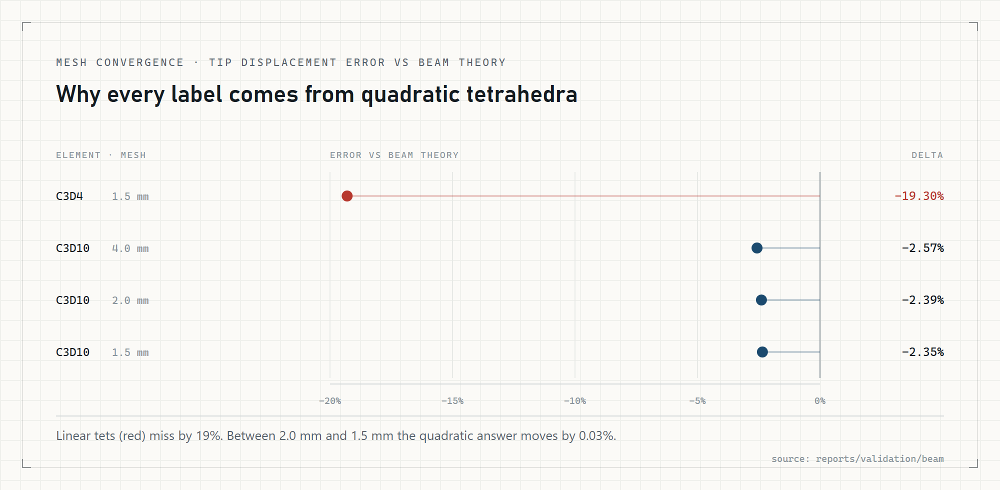

Linear tetrahedra are a trap for bending problems: at practical mesh sizes they
underpredict tip displacement by 19%. Quadratic elements converge to within
2.35%, and — more important than the residual — stop moving: between a 2.0 mm
and a 1.5 mm mesh the answer shifts by 0.03%. That convergence, not the absolute
error, is the evidence that the discretisation is resolved.

The residual 2.35% gap is not noise. It is the difference between a fully clamped
3D face and the idealised clamp of Euler–Bernoulli beam theory, which is
measurably stiffer than reality. When the beam gets slender enough (length over
thickness of 40) the gap shrinks to 1.4% and the mid-span stress matches theory
to 0.08%.

Every artifact carries its ancestry.

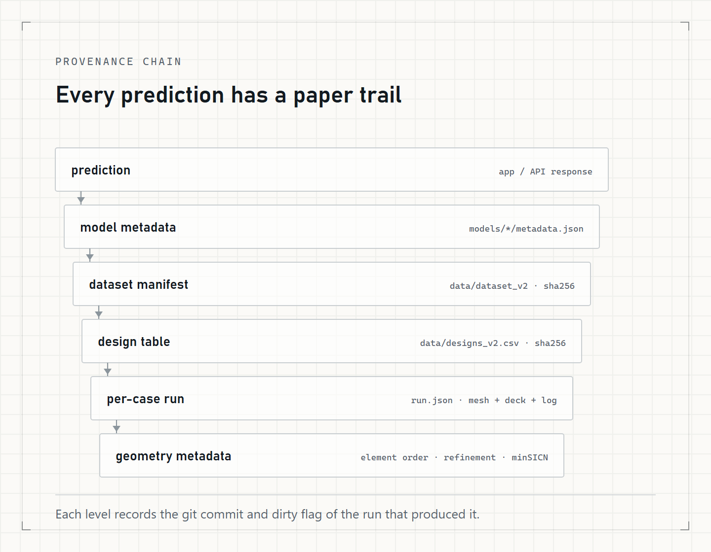

Any prediction can be traced back through the model metadata, the dataset
manifest, the design table, the individual run record and the mesh metadata —
each level recording the SHA-256 of its inputs and the git commit of the run
that produced it. If a number in this post is wrong, there is a path to the
evidence.

## How close the predictions actually are

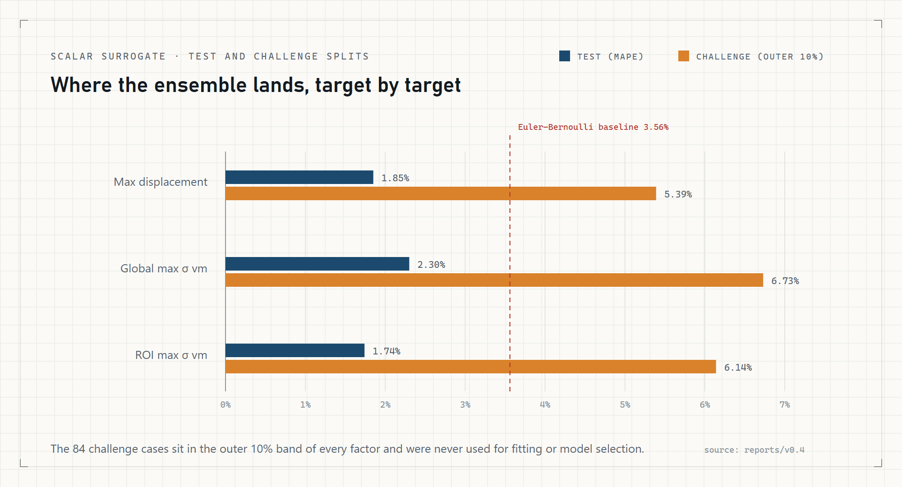

On the test split the shape-conditioned ensemble lands at 1.74–2.30% mean
absolute percentage error across the three targets: maximum displacement, global
peak von Mises stress, and peak stress inside the stress-riser region.

Two things keep that number honest. First, the comparison that matters is
against what an engineer would do without a solver — the closed-form beam
formula, at 3.56%. Second, the distribution has a tail: the worst single test
case in each target is off by 8.9%, 12.4% and 9.1% respectively, and on the
held-out challenge split the medians rise to 5–7% with individual cases far
worse. A mean absolute percentage error of 1.8% is a statement about the middle
of a distribution, not a promise about the case in front of you.

That is why the field model is judged differently.

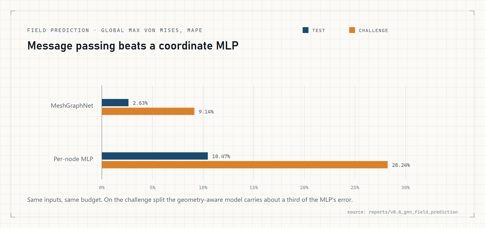

The field model predicts stress at every node rather than one number, which is a
much harder task. It reaches 2.63% error on the global peak stress in test and
0.80% median nodal error, against 10.47% and 1.73% for an otherwise identical
per-node network that sees coordinates but not connectivity. On the challenge
split the gap widens to 9.14% versus 28.24% — the clearest evidence in the whole
project that representing the mesh as a graph, and letting nodes exchange
messages, is doing real work rather than absorbing extra parameters.

## What it looks like to use

The models are wrapped in an application rather than a notebook, because
confidence is a user-interface problem.

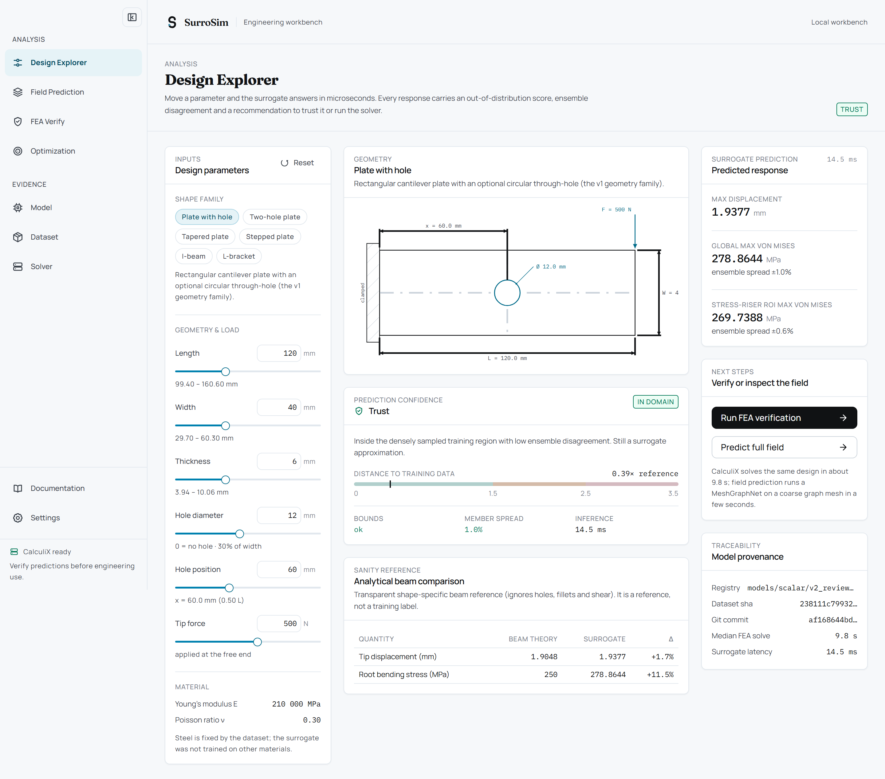

Move a slider and the prediction updates immediately. Alongside it sits the part
that matters: an out-of-distribution score measured as distance to the nearest
training designs, the spread between ensemble members, and a plain-language
recommendation — *trust*, *caution*, or *run the solver*. The panel below it
shows the analytic beam estimate for comparison, so the surrogate is never the
only opinion on screen.

When the recommendation is "run the solver", the app can actually do it, in the
background, on the same design.

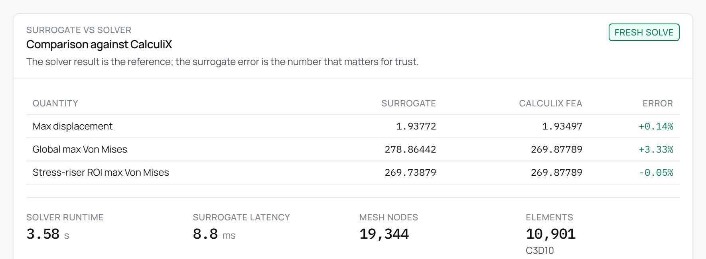

This is the loop closing. The surrogate claimed 1.93772 mm of tip displacement;
CalculiX, on a 19,344-node mesh of 10,901 quadratic elements, returned 1.93497.
The peak stress was over-predicted by 3.3%, which is the safe direction to be
wrong in. Verification takes a few seconds — acceptable once, unacceptable ten
thousand times, which is exactly the trade the surrogate is meant to make.

The field model has its own viewer, because "peak stress is 268 MPa" is much
less useful than seeing where it is.

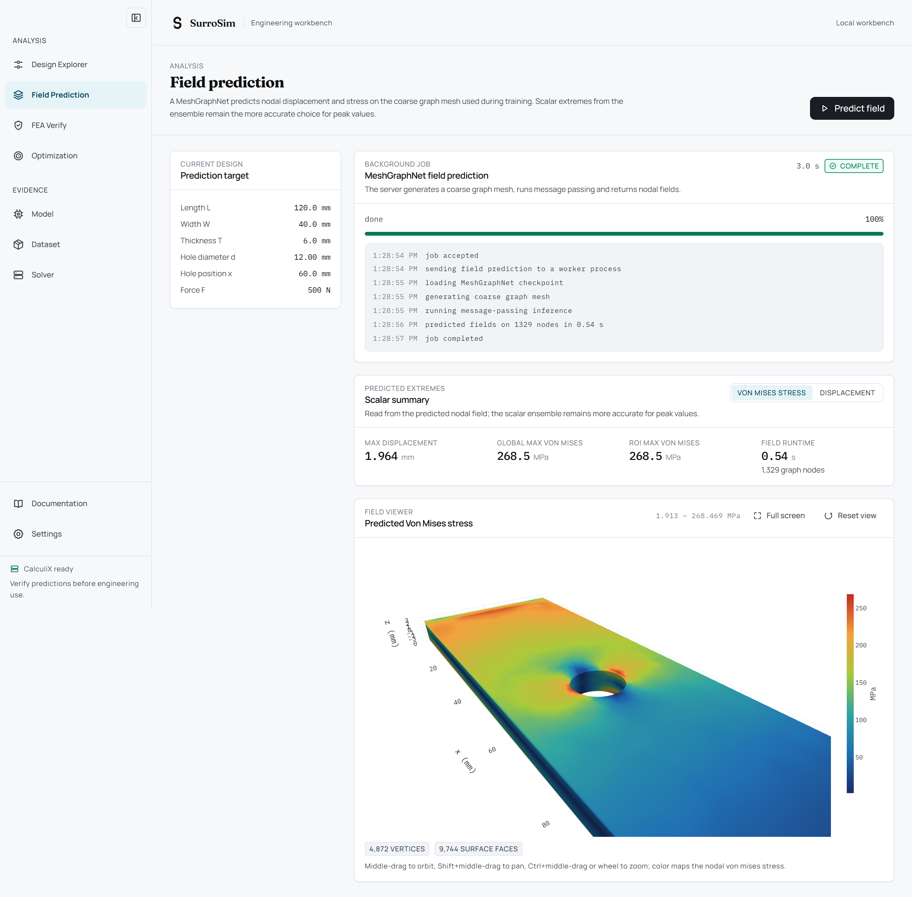

## Closing the loop: searching instead of checking

Once a prediction costs microseconds, the economics of design change. Instead of
proposing a design and checking it, you can search a space.

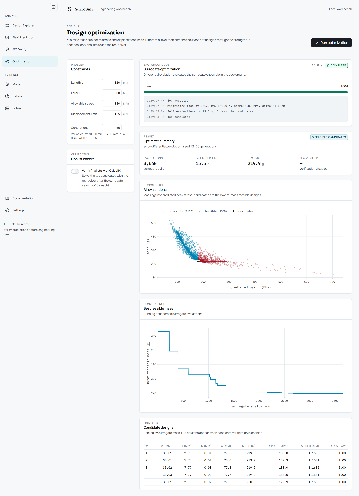

This is differential evolution running against the surrogate: minimise mass
subject to peak stress below 180 MPa and tip displacement below 1.5 mm. A single
run evaluates 3,660 candidates in about 17 seconds — and then, crucially, only
the handful of finalists go to the real solver. In the recorded run all five
finalists proved feasible under FEA, with the surrogate's stress estimate
conservative by 0.4–2.3%.

That is the shape of the whole idea: the surrogate does the searching, the solver
does the deciding.

## What SurroSim is not

This is the section that makes the rest of the post usable, so it is not a
formality.

- **Linear elasticity only.** No plasticity, contact, buckling, vibration or
  thermal effects. Many dataset cases exceed 250 MPa; those are valid
  linear-elastic solutions and nothing more.
- **One load case.** A single transverse force at the free end. No pressure,
  gravity, moments or multi-axial loading.
- **A closed design space.** Predictions outside the sampled parameter ranges are
  unsupported. The app raises bound violations; it cannot make them go away.
- **No experimental validation.** Every number here is checked against beam
  theory, mesh refinement and solver self-consistency. Nobody has pulled a test
  coupon in a lab.
- **Heuristic confidence.** The out-of-distribution score is a distance in
  feature space, not a calibrated probability. Unusual geometry inside the
  parameter box can still score as safe.
- **Not a certified tool.** It is an engineering-surrogate research platform with
  a working application attached. Predictions are not design approvals, and a
  qualified engineer remains responsible for the conclusions drawn from them.

## Running it

Python 3.11+ and CalculiX. The quick profile runs the whole chain — sample,
solve, gate, train, evaluate — in about four minutes on a normal machine:

```bash
python -m venv .venv
.venv/Scripts/python -m pip install -e '.[dev,mesh,ml,app,gnn]'
python -m surrosim reproduce --profile quick --jobs 4 --ccx tools/calculix/ccx.exe
```

The application, with the pre-trained registries in this checkout:

```bash
python -m surrosim serve --port 8003 \
    --registry models/scalar/v2_reviewed_candidate \
    --field-model models/gnn/v2_normalized_candidate
```

A desktop shell, a Docker compose file, an HTTP API and a `surrosim` CLI cover
the other ways in. Everything runs offline; nothing here phones home.

## Why build it this way

Most machine-learning projects optimise a metric. This one optimises a different
question: *would an engineer sign off on this?* That question forces the gating,
the provenance chain, the held-out challenge split, the convergence study, the
out-of-distribution checks and the verification button — none of which improve a
test-set score, and all of which decide whether a number is worth acting on.

The result is a system that is fast in the way a calculator is fast, and cautious
in the way a good engineer is cautious.

---

*All figures in this post were generated from the repository's own validation
reports and live application. The consolidated evidence, including the tables
behind every number quoted here, is in
[`docs/validation_report.md`](../docs/validation_report.md); the scope and limits
are in [`docs/limitations_and_out_of_scope.md`](../docs/limitations_and_out_of_scope.md).*
