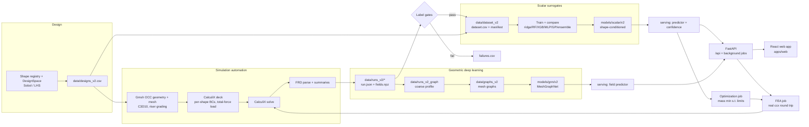

# SurroSim architecture

## System view



## Module map

| Package | Responsibility |
| --- | --- |
| `surrosim.shapes` | Shape registry: parameters, validation, mass, ROI, beam reference, load direction |
| `surrosim.plate` | Flat design record (shape + superset params), validation dispatch, beam reference |
| `surrosim.mesh_policy` | Production and graph mesh profiles (traceable per case) |
| `surrosim.sampling` | Per-shape design spaces, Sobol/LHS sampling, challenge/edge cases, splits |
| `surrosim.geometry` | Per-shape Gmsh OCC builders, physical groups, mesh + quality metadata |
| `surrosim.simulation` | MSH2 parser, CalculiX deck, process runner, FRD parser, pipeline |
| `surrosim.validation` | Beam and mesh convergence studies with committed reports |
| `surrosim.dataset` | Resumable parallel batch runs, label gating, manifest, dataset card |
| `surrosim.ml` | Features, baselines, scalar model adapters, training/reporting |
| `surrosim.gnn` | Mesh-graph export, MeshGraphNet + MLP baseline, training/eval |
| `surrosim.serving` | Predictor with confidence/OOD, field predictor, FastAPI + jobs, plotly viz |
| `surrosim.optimize` | Constrained mass minimization with FEA verification of finalists |
| `surrosim.reproduce` | One-command quick/full pipeline execution |

## Provenance chain

```
prediction (app/API)
  └─ model metadata      models/*/metadata.json  (config, seed, metrics, features)
       └─ dataset sha256  data/dataset_v2/manifest.json
            └─ designs sha256  data/designs_v2.csv
                 └─ per-case run.json  (mesh policy, deck summary, solver log, runtime)
                      └─ geometry metadata  (element order, refinement, minSICN)
```

Every level records the git commit (and dirty flag) of the run that produced
it, so any prediction can be traced back to the exact mesh, deck and solver
output that validated it. `fields.npz` retains the nodal ground truth.

## Design decisions

- **Shape registry as the single source of truth**: each family declares its
  active parameters, boundary-condition faces, load DOF/sign, stress-riser
  ROI, analytic mass and beam reference. The flat design record is a superset
  so CSV schemas, the API and stored registries stay stable as shapes are
  added.
- **Quadratic tetrahedra** are mandatory for bending accuracy (see
  validation report); linear tets are supported but not used for data.
- **Fillets where stress would be singular**: stepped, I-beam and L-bracket
  shapes are filleted at re-entrant corners and the production mesh grades
  those fillets; sharp re-entrant corners are deliberately out of scope.
- **Total-force load semantics**: the requested force is distributed to the
  load face with consistent nodal loads, so mesh refinement never changes the
  applied load.
- **Riser-graded meshes** (holes and fillets) keep peak-stress labels stable
  without refining the whole part.
- **Failures never become labels**: solver status, force balance, mesh size,
  field presence and output positivity are all gated.
- **Two mesh profiles**: production (accuracy) for scalar labels; graph
  (coarse) for GNN training, where solve cost per case drives feasibility.
- **Shape-conditioned models**: dataset v2 carries a `shape` column plus
  one-hot features, so one scalar ensemble and one MeshGraphNet serve every
  family while v1 plate registries remain loadable.
- **Confidence before convenience**: the app exposes bounds/OOD/disagreement
  and recommends running the solver when support is weak.
